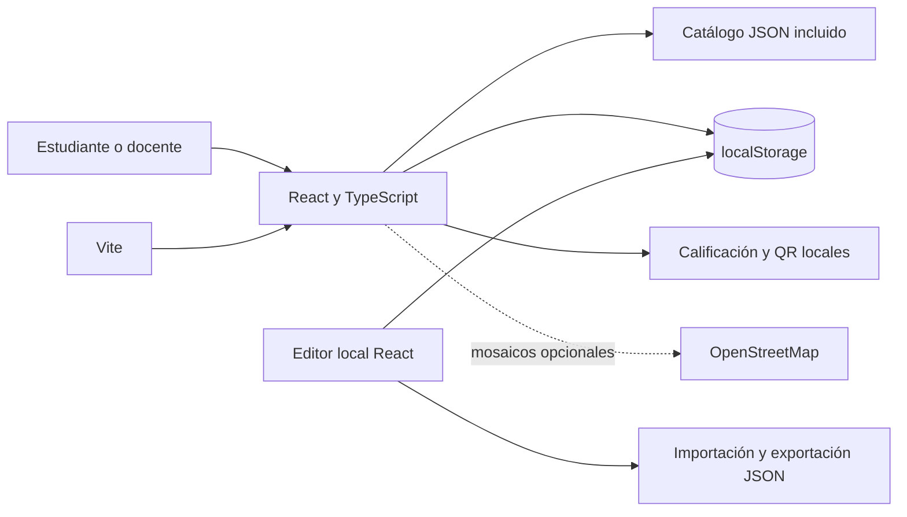
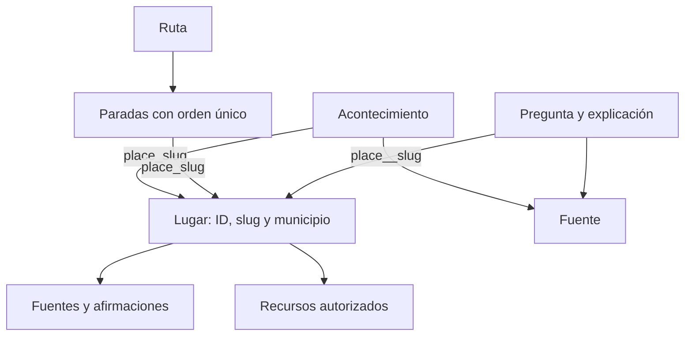
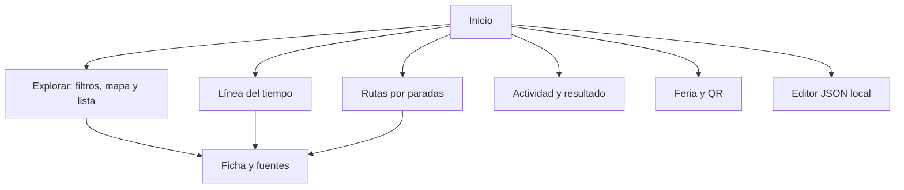

# Diagramas del sistema

## Arquitectura

Un único servidor sirve la aplicación. content.ts valida el catálogo, resuelve relaciones y califica preguntas. No hay API ni base de datos de servidor. Una edición válida guardada en el navegador tiene prioridad sobre el catálogo incluido.

## Relaciones

IDs y slugs únicos por colección; referencias existentes; coordenadas completas con fuente verificada; fichas revisadas con afirmaciones respaldadas. Se validan opciones e índice de respuesta. Los recursos incluidos deben tener permiso de publicación; no hay cola de aprobación en servidor.

## Navegación

La edición afecta solo al navegador y origen actual. No requiere sesión y no modifica los archivos del proyecto. La exportación permite trasladar cambios manualmente.
